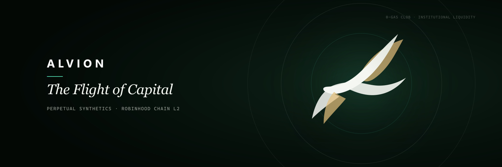
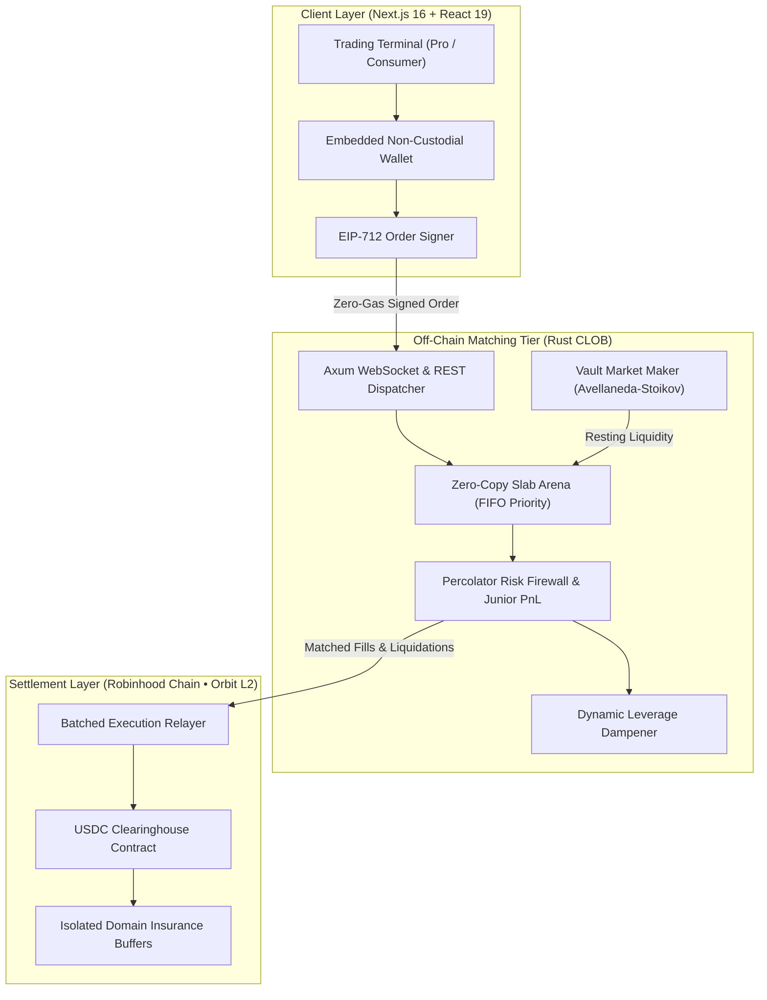

<p align="center">
  
</p>

<h1 align="center">Alvion</h1>

<p align="center">
  <strong>High-Frequency Decentralized Perpetual Exchange & Risk Engine for Tokenized Equities & Crypto</strong>
</p>

<p align="center">
  <a href="#system-architecture"></a>
  <a href="#rust-clob-matching-engine"></a>
  <a href="#settlement--chain-layer"></a>
  <a href="#zero-gas-eip-712-execution"></a>
  <a href="#testing--verification"></a>
</p>

<p align="center">
  
</p>

---

## Table of Contents

- [Overview](#overview)
- [System Architecture](#system-architecture)
- [Core Trading & Risk Mechanics](#core-trading--risk-mechanics)
  - [1. Rust Zero-Copy CLOB Matching Engine](#1-rust-zero-copy-clob-matching-engine)
  - [2. Percolator-Inspired Source-Domain Risk Firewall](#2-percolator-inspired-source-domain-risk-firewall)
  - [3. Dynamic Leverage Dampener (Yakovenko Specification)](#3-dynamic-leverage-dampener-yakovenko-specification)
  - [4. Single USDC Vault Market Maker (Avellaneda-Stoikov Skew)](#4-single-usdc-vault-market-maker-avellaneda-stoikov-skew)
  - [5. Adaptive Dynamic Funding Rate](#5-adaptive-dynamic-funding-rate)
  - [6. QFEX-Style Real-Time Account Value & Margin System](#6-qfex-style-real-time-account-value--margin-system)
- [Markets Supported](#markets-supported)
- [Domain-Driven Vertical Slice Layout](#domain-driven-vertical-slice-layout)
- [Technology Stack](#technology-stack)
- [Getting Started](#getting-started)
  - [Prerequisites](#prerequisites)
  - [Frontend Setup](#frontend-setup)
  - [Rust Matching Engine Setup](#rust-matching-engine-setup)
- [Testing & Quality Assurance](#testing--quality-assurance)
- [Security & Invariants](#security--invariants)
- [License](#license)

---

## Overview

**Alvion** is an institutional-grade decentralized perpetual futures exchange designed for 24/7 trading of **tokenized NYSE/NASDAQ equities** (SPY, QQQ, NVDA, TSLA, AAPL, etc.) and **crypto perps** (BTC, ETH, SOL, AVAX) with up to **1000x dynamic leverage**.

Built on a hybrid architecture, Alvion fuses the execution velocity and capital efficiency of a centralized limit order book with the sovereign security of decentralized settlement:
- **Off-Chain Execution**: Sub-millisecond, deterministic Price-Time Priority matching engine written in Rust using zero-copy slab memory arenas.
- **On-Chain Settlement**: Batched relayer settlement and collateral clearing on **Robinhood Chain (Arbitrum Orbit L2 • Chain ID `4663`)**.
- **Cryptographic Orders**: 1-click off-chain order placement and cancellation signed via **EIP-712** structured data through embedded non-custodial wallets (zero gas for order management).
- **Mathematical Risk Firewall**: Source-Domain Junior PnL firewalls and dynamic leverage dampening that protect the core USDC liquidity vault against long-tail contagion and cascade liquidations.

---

## System Architecture



---

## Core Trading & Risk Mechanics

### 1. Rust Zero-Copy CLOB Matching Engine
Located in [`clob-engine/`](./clob-engine), the matching engine is written in pure Rust for high-throughput, low-latency execution:
- **Deterministic Fixed-Point Math**: Replaces floating-point imprecision with integer scaling (`PRICE_SCALE = 1e6`, `USD_SCALE = 1e6`).
- **Zero-Copy Slab Arenas**: Intrusive doubly-linked memory slabs avoid dynamic allocations on the critical matching path.
- **Dual-Gate Margin Verification**: Validates trader collateral at initial order intake and re-verifies immediately before execution match.

### 2. Percolator-Inspired Source-Domain Risk Firewall
To prevent manipulated price wicks or illiquid anomalies on volatile assets from draining the core liquidity vault, each market operates as an isolated **Risk Domain** with its own Junior PnL ceiling:
$$\text{Realizable PnL}_{\text{market}} \le \text{Isolated Insurance Fund}_{\text{market}}$$
- Volatile equity and crypto pairs are strictly bounded to their dedicated domain insurance buffer.
- Realized profits cannot exceed the domain's risk ceiling, protecting single-vault USDC liquidity providers against cross-market contagion.

### 3. Dynamic Leverage Dampener (Yakovenko Specification)
Rather than exposing the exchange to cascading liquidations under extreme leverage, Alvion monitors the **Open Interest Skew Utilization**:
$$\text{Utilization} = \frac{|\text{Long OI} - \text{Short OI}|}{2 \times \text{Insurance Buffer}} \times 100\%$$

| Skew Utilization | Status | Max Allowed Leverage | Risk Guardrail |
| :---: | :---: | :---: | :--- |
| **$< 50\%$** | `OPTIMAL` | **1000x** | Full trading capacity unlocked |
| **$50\% - 75\%$** | `DAMPENED` | **100x** | Dynamic buffer compression |
| **$75\% - 90\%$** | `GUARDED` | **50x** | Aggressive exposure dampening |
| **$\ge 90\%$** | `RESTRICTED` | **10x** | Emergency ceiling; stops cascade risk |

### 4. Single USDC Vault Market Maker (Avellaneda-Stoikov Skew)
Located in [`clob-engine/src/vault_mm.rs`](./clob-engine/src/vault_mm.rs), the automated vault MM quotes layered bids and asks directly into the CLOB:
- Generates 3 ladder levels of dual-sided depth centered around the live oracle price.
- Dynamically offsets quoting prices using inventory skew:
  $$\text{Skew Offset}_{\text{bps}} = \text{Net Skew Ratio} \times 30$$
- Rebalances order depth every 5 minutes or upon significant oracle delta.

### 5. Adaptive Dynamic Funding Rate
Balances market demand between long and short open interest without arbitrary administrative fees:
$$\text{Adaptive Funding Rate} = \text{Orderbook Premium} + \text{Vault Inventory Skew}$$
Arbitrageurs are incentivized to step in and restore market symmetry whenever open interest diverges from the reference index.

### 6. QFEX-Style Real-Time Account Value & Margin System
The terminal features live institutional portfolio inspection matching professional derivatives exchanges:
$$\text{Account Value (Total Equity)} = \text{Available Balance} + \text{Position Margin} + \text{Order Margin} + \text{Unrealized PnL}$$
- **Available Balance**: Unencumbered collateral ready to trade or withdraw.
- **Position Margin**: Margin collateral locked across open positions.
- **Order Margin**: Collateral reserved for active resting limit orders.
- **Unrealized PnL**: Mark-to-market floating profit/loss updated continuously.
- **Anti-Slop Craftsmanship**: 100% solid, non-transparent terminal styling with 150ms anti-flicker grace periods, keyboard accessibility (`Escape`), and zero cosmetic AI clutter.

---

## Markets Supported

Alvion provides 24/7 continuous liquidity across 15 perpetual pairs:

| Category | Symbols | Default Max Leverage | Settlement Asset |
| :--- | :--- | :---: | :--- |
| **Tokenized Equities (Indices)** | `SPY-USDCx`, `QQQ-USDCx` | 1000x | USDC (Robinhood Chain) |
| **Tokenized Equities (Tech/Mega-Cap)** | `NVDA`, `TSLA`, `AAPL`, `MSFT`, `AMZN`, `GOOGL`, `META` | 1000x | USDC (Robinhood Chain) |
| **Crypto-Native Equities** | `COIN-USDCx`, `MSTR-USDCx` | 1000x | USDC (Robinhood Chain) |
| **Core Crypto Perps** | `BTC-USDCx`, `ETH-USDCx`, `SOL-USDCx`, `AVAX-USDCx` | 1000x | USDC (Robinhood Chain) |

---

## Domain-Driven Vertical Slice Layout

The frontend architecture in [`src/components/trading/`](./src/components/trading) is organized into bounded vertical slices:

```
src/components/trading/
├── chart/                # Lightweight Charts & TradingView engines
│   ├── TradingChart.tsx
│   ├── TradingViewChart.tsx
│   ├── AlvionNativeChart.tsx
│   └── index.ts
├── order-entry/          # Pro order controls, consumer mode, sliders
│   ├── OrderPanel.tsx
│   ├── OrderPanelPro.tsx
│   ├── OrderPanelConsumer.tsx
│   └── index.ts
├── orderbook/            # High-frequency depth order book & tabs
│   ├── OrderBookView.tsx
│   ├── FullOrderBookTab.tsx
│   └── index.ts
├── portfolio/            # Positions, trades, secondary tabs, backstop
│   ├── PositionsPanel.tsx
│   ├── VaultBackstopTab.tsx
│   ├── CreditsTab.tsx
│   ├── ArchitectureDocsTab.tsx
│   └── index.ts
├── layout/               # Header, ticker bar, firewall, account hover card
│   ├── TradingHeader.tsx
│   ├── TradingFooter.tsx
│   ├── MarketTickerBar.tsx
│   ├── RiskFirewallBar.tsx
│   ├── AccountValueHoverCard.tsx
│   └── index.ts
├── modals/               # Ephemeral overlays (Account, Market, Share PnL)
│   ├── AccountModal.tsx
│   ├── MarketSelectorModal.tsx
│   ├── SharePnlModal.tsx
│   └── index.ts
├── shared/               # Reusable presentation primitives
│   ├── MarketIcon.tsx
│   ├── NotificationToast.tsx
│   └── index.ts
└── index.ts              # Root public barrel export
```

---

## Technology Stack

- **Frontend Core**: [Next.js 16](https://nextjs.org/) (App Router), [React 19](https://react.dev/), [TypeScript 5](https://www.typescriptlang.org/)
- **Styling & Tokens**: [Tailwind CSS v4](https://tailwindcss.com/), Lucide Icons
- **State & Data**: [Zustand 5](https://zustand-demo.pmnd.rs/), [TanStack Query 5](https://tanstack.com/query)
- **Financial Visualization**: [TradingView Lightweight Charts v5](https://www.tradingview.com/lightweight-charts/), [@number-flow/react](https://number-flow.barvian.me/)
- **Matching Engine**: [Rust 2021 Edition](https://www.rust-lang.org/), [Tokio](https://tokio.rs/), [Axum 0.8](https://github.com/tokio-rs/axum), `rustc-hash`
- **Web3 & Cryptography**: [Viem 2](https://viem.sh/), [Wagmi 3](https://wagmi.sh/), `tiny-keccak` (EIP-712 typing)

---

## Getting Started

### Prerequisites
- **Node.js**: `>= 20.0.0`
- **npm**: `>= 10.0.0`
- **Rust Toolchain**: `>= 1.75.0` (`rustc`, `cargo`)

### Frontend Setup

1. **Clone the repository**:
   ```bash
   git clone https://github.com/your-org/alvion.git
   cd alvion
   ```

2. **Install dependencies**:
   ```bash
   npm install
   ```

3. **Start the Next.js development server**:
   ```bash
   npm run dev
   ```
   Open [http://localhost:3000](http://localhost:3000) in your browser.

4. **Build for production**:
   ```bash
   npm run build
   npm run start
   ```

### Rust Matching Engine Setup

To run the standalone high-frequency CLOB engine locally:

```bash
# Run CLOB engine in release mode
cargo run --release --manifest-path clob-engine/Cargo.toml

# Or via npm script alias
npm run engine
```

The WebSocket server binds to `127.0.0.1:8080`, exposing real-time order submission, cancellation, and depth feed streaming.

---

## Testing & Quality Assurance

Alvion maintains a zero-warning, zero-error engineering policy across all layers:

### 1. TypeScript Static Analysis
```bash
npx tsc --noEmit
```

### 2. ESLint Static Analysis
```bash
npm run lint
```

### 3. Rust CLOB Engine Test Suite
Comprehensive unit and integration test coverage across the matching core, memory layouts, and risk models:
```bash
cargo test --manifest-path clob-engine/Cargo.toml
```

**Passing Test Verification (19/19)**:
- `slab::tests::test_fifo_matching_order` (Deterministic Price-Time Priority matching)
- `slab::tests::test_intrusive_unlinking_at_any_position` (Zero-copy slab manipulation)
- `slab::tests::test_slab_order_compact_memory_layout` (Memory packing verification)
- `domain::tests::test_1000x_leverage_liquidation_math` (Sub-basis-point liquidation math)
- `domain::tests::test_percolator_dynamic_leverage_dampener` (Buffer skew downscaling)
- `robinhood::tests::test_keccak256` & `test_robinhood_address_validation` (EIP-712 cryptographic verification)
- `engine::tests::test_sequencer_tick_purges_expired_with_retain` (Atomic orderbook expiration)
- `ws::tests::test_ws_broadcaster_dispatch` & `test_parse_client_message_formats` (Client socket pipelines)

---

## Security & Invariants

1. **Strict Solvency Invariant**:
   $$\sum \text{Collateral Deposits} + \text{Vault Reserves} \ge \sum \text{Open Margin} + \sum \text{Unrealized Gains}$$
2. **Non-Custodial Architecture**:
   - Trader funds reside in smart contract vaults.
   - Off-chain engine possesses execution authorization only through valid EIP-712 signatures.
   - Private keys are stored in secure local storage or hardware enclaves; keys are never transmitted to backend servers.
3. **Contagion Isolation**:
   - Equities and crypto risk domains are cryptographically isolated. A catastrophic liquidation cascade in an equity market (e.g. TSLA earnings gap) cannot draw upon the insurance funds of BTC or SPY.

---

## License

This project is licensed under the MIT License - see the [LICENSE](LICENSE) file for details.

<p align="center">
  <sub>Engineered with precision for institutional decentralized finance.</sub>
</p>
